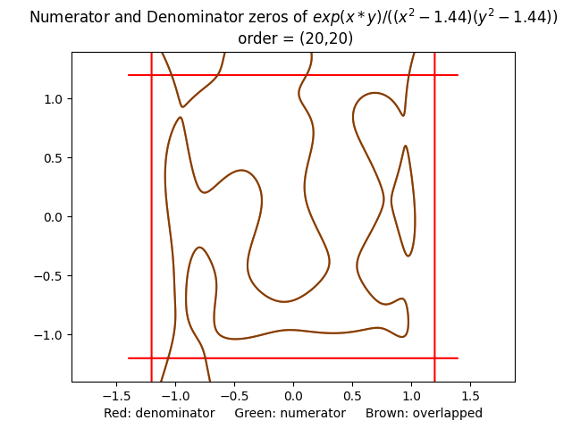
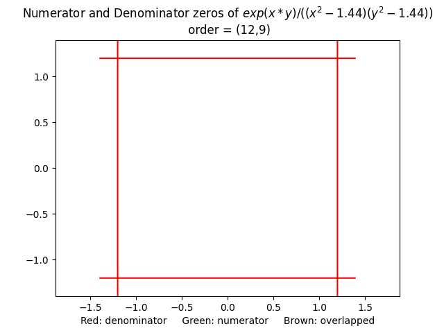

# VanderRat

This package is a Julia implementation of some of the algorithms presented 
paper [Practical algorithms for multivariate rational approximation](https://doi.org/10.1016/j.cpc.2020.107663) (It does not implement the Algorithm 4.1)

## The algorithm

More here later.


## Examples

```julia
using LinearAlgebra
using Random
using VanderRat
using BenchmarkTools

# Example A.5.1 in [1]
nvarf(x) = exp(prod(x)) / prod([(y^2 - 1.44) for y in x])

k=1000
n=2
M=20
N=20

x = 2*rand(k, n) .- 1.0
ff = nvarf.(eachrow(x))

@btime vf = VanderRat.vrfit($x, $ff, $M, $N);

# julia 1.14> @btime vf = VanderRat.vrfit($x, $ff, $M, $N);
#   60.621 ms (3762 allocations: 30.12 MiB)

# Random sample points and random test points. What's the worry?
# when n=3, error is a min at M=N=11 (only tested M=N) Error gets
# larger for higher orders eventually triggering a rank deficient error
# because number of sample points is less than the number of basis functions
# We now give a warning when that happens.
function nvartest(func=nvarf; llim=-1.0, ulim=1.0, k=1000, n=2, M=20, N=20)
    Random.seed!(137)
    x = llim .+ (ulim - llim)*rand(k, n)
    f = func.(eachrow(x))
    vf = VanderRat.vrfit(x, f, M, N)
    # test at 2000 random locations
    xx = llim .+ (ulim - llim)*rand(2000, n)
    return norm(abs.(func.(eachrow(xx)) - vrval.(eachrow(xx), (vf,))), Inf)
end

julia 1.14> nvartest()
2.551238509340692e-8

```

And here is an example using the degree reduction algorithm:

```julia
using LinearAlgebra
using Random
using VanderRat
using PyPlot

# One of the functions from the paper
nvarf(x) = exp(prod(x)) / prod([(y^2 - 1.44) for y in x])

function meshgrid(x, y=x)
    xx = ones(length(y)) * x'
    yy = y * ones(length(x))'
    return xx, yy
end

function show_contrs(vf, fstrg)
    # We access veval directly because we want the numerator and the
    # denominator separately so we can contour plot them separately.
    f(x) = veval(x, vf.b, vf.RL, vf.N, length(vf.f)) # denominator of rational poly
    g(x) = veval(x, vf.a, vf.RL, vf.M, length(vf.f)) # numerator of rational poly

    # we built the rational poly with both -1.0 < x,y < 1.0 but we want
    # to see outside that range
    r = [-1.4:0.005:1.4;]

    n = length(r)
    xx, yy = meshgrid(r)

    zz = [vec(xx) vec(yy)]
    
    ZF = f.(eachrow(zz))    # denominator values
    ZF = reshape(ZF, n, n)  # on a square grid
    
    ZG = g.(eachrow(zz))
    ZG = reshape(ZG, n, n)
    
    contour(xx, yy, ZF, [0.0], colors="r")
    contour(xx, yy, ZG, [0.0], colors="g", alpha=0.5)

    title("Numerator and Denominator zeros of $fstrg\n order = ($(vf.M),$(vf.N))")
    xlabel("Red: denominator     Green: numerator     Brown: overlapped")
end


function fcheb(;k=32, n=2, M=20, N=20, seed=137)
    Random.seed!(seed)
    x = VanderRat.chebpts(k)
    xx, yy = meshgrid(x)
    zz = [vec(xx) vec(yy)]
    ff = nvarf.(eachrow(zz))
    vf = VanderRat.vrfit(zz, ff, M, N)
    show_contrs(vf, "\$exp(x*y)/((x^2-1.44)(y^2-1.44))\$")
    axis("equal")
    savefig("zeros_example_orig.png", format="png")
    clf()
    
    vff = VanderFit(vf)
    degreduce!(vff, 12, 9)
    show_contrs(vff, "\$exp(x*y)/((x^2-1.44)(y^2-1.44))\$")
    axis("equal")
    savefig("zeros_example_reduced.png", format="png")

    # the values at a random test point
    xx = rand(n)
    println(" test point : ", xx)
    println("                    true value : ", nvarf(xx))
    println("original rational poly (20,20) : ", vrval(xx, vf))
    println(" reduced rational poly (12, 9) : ", vrval(xx, vff))
end

#    julia 1.14> fcheb()
#     test point : [0.46601339494135385, 0.966015087762196]
#                        true value : 2.5310048948790356
#    original rational poly (20,20) : 2.5310048948790587
#    reduced rational poly (12, 9)  : 2.5310048948781994
```

Here we have specified a (20, 20) rational polynomial, which is,
at least for the denominator where we know it is only of degree
4, way over doing it. Plotting the zeros of the numerator and the
denominator gives the following:



We see immediately that the algorithm has picked out
the explicit poles at x = +/- 1.2 and y = +/- 1.2. Not surprising,
given a denominator order of 20. But also with that high an order,
we see an interesting pattern of denominator zeros that are exactly
cancelled out by numerator zeros. This is a recurring pattern in 
many rational approximations and is explicitly relied on in the
barycentric forms of approximation. (ATAP reference ?)

We can use the degree reduction algorithm to reduce the degree of 
the rational polynomial to (12,9). The 9 is still much more than is
needed but we see now that all but the explicit zeros of the denominator
have been taken care of:




## Notes

This was written when only the preprint of the paper was available, so the
comments in the code may not match the paper.

The code has not yet been optimized.

While the tests are from Section 5 of the paper, their implementation was
borrowed from [3]

This package also contains an implementation of [Vandermonde with Arnoldi](https://epubs.siam.org/doi/pdf/10.1137/19M130100X)

## References

[1] [Practical algorithms for multivariate rational approximation](https://doi.org/10.1016/j.cpc.2020.107663)

[2] [Vandermonde with Arnoldi](https://epubs.siam.org/doi/pdf/10.1137/19M130100X)


